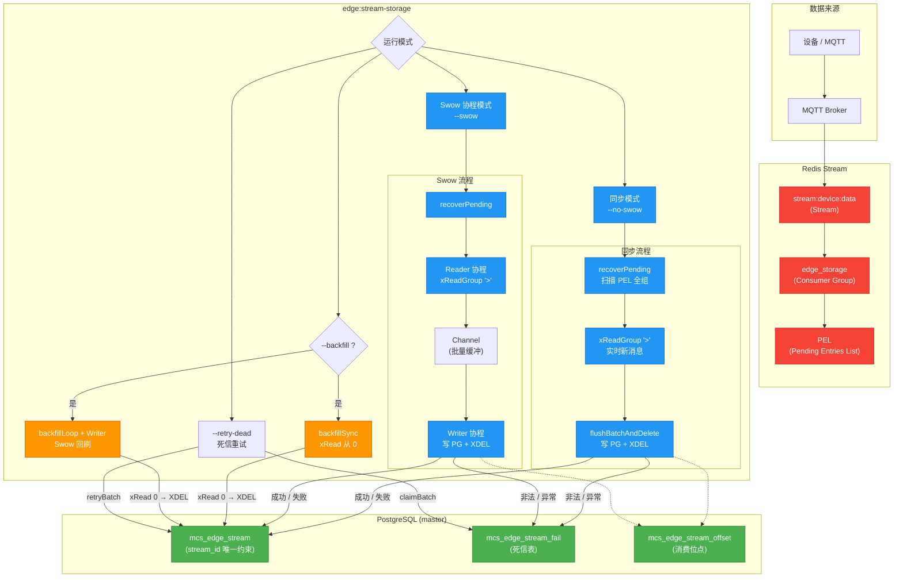

# edge:stream-storage 使用与运维手册

> 本文档覆盖命令调用、数据流转、故障排查、架构图和测试数据灌入。
> 所有内容基于当前实现：`mcs_edge_stream` / `mcs_edge_stream_fail` / `mcs_edge_stream_offset` 三张真实表，以及 Redis Stream `stream:device:data`。

---

## 目录

- [1. 命令简介](#1-命令简介)
- [2. 核心参数](#2-核心参数)
- [3. 运行模式](#3-运行模式)
- [4. 历史存量回刷（--backfill）](#4-历史存量回刷--backfill)
- [5. 死信重试（--retry-dead）](#5-死信重试--retry-dead)
- [6. 启动行为说明](#6-启动行为说明)
- [7. 数据清理策略](#7-数据清理策略)
- [8. 常用运维命令](#8-常用运维命令)
- [9. 典型场景示例](#9-典型场景示例)
- [10. 信号处理与优雅停机](#10-信号处理与优雅停机)
- [11. 常见问题 FAQ](#11-常见问题-faq)
- [12. 输出日志说明](#12-输出日志说明)
- [13. 架构流程图（Mermaid）](#13-架构流程图mermaid)
- [14. 测试数据灌入脚本](#14-测试数据灌入脚本)
- [附录 A. 故障排查速查表](#附录-a-故障排查速查表)

---

## 1. 命令简介

`edge:stream-storage` 从 Redis Stream 消费设备数据并写入 PostgreSQL，支持：

- 实时消费（同步 / Swow 协程）
- 启动时自动恢复 PEL 存量消息（跨 consumer 认领）
- 历史存量数据独立回刷（不碰消费组）
- 死信重试
- 消费成功后自动 `XDEL` 清理 Redis 数据
- 写 PG 失败 / 非法数据一律进死信并 `XDEL`，不阻塞 Stream

---

## 2. 核心参数

| 参数 | 默认值 | 说明 |
|------|--------|------|
| `--stream` | `stream:device:data` | Redis Stream 名称 |
| `--group` | `edge_storage` | 消费组名称 |
| `--consumer` | `worker_1` | 消费者名称 |
| `--batch` | `50` | 每批消费/写入数量 |
| `--timeout` | `2000` | 阻塞读取超时（毫秒），同时用于 advisory lock 超时 |
| `--channel-size` | `2048` | Swow Channel 队列长度 |
| `--max-payload` | `65536` | 单条 payload 最大长度（字节），超长进死信 |
| `--max-retries` | `3` | 死信最大重试次数 |
| `--retry-batch` | `50` | 死信重试批次大小 |
| `--swow` | — | 强制 Swow 协程模式 |
| `--no-swow` | — | 强制同步模式 |
| `--once` | — | 一批即退 |
| `--retry-dead` | — | 仅执行死信重试 |
| `--backfill` | — | 独立 `XREAD` 回刷历史存量，不碰消费组 |

---

## 3. 运行模式

### 3.1 自动模式（推荐）

```bash
php artisan edge:stream-storage
```

- Windows：强制同步模式
- Linux + 安装 Swow：自动使用 Swow 协程模式

### 3.2 同步模式（开发 / 调试）

```bash
php artisan edge:stream-storage --no-swow
php artisan edge:stream-storage --no-swow --once --batch=10
```

适合 Windows 本地开发、单次调试、容器环境。

### 3.3 Swow 协程模式（生产推荐）

```bash
php artisan edge:stream-storage --swow
```

Reader / Writer 分离，高并发、低延迟。

### 3.4 单次运行模式

```bash
php artisan edge:stream-storage --no-swow --once
```

处理一批即退，适合调试或定时任务。

---

## 4. 历史存量回刷（--backfill）

**不创建消费组、不改消费组游标、不 ACK**，使用 `XREAD` 从 `0` 独立消费历史数据，读完即 `XDEL`。与实时消费完全隔离。

```bash
# 同步回刷（Windows / 通用）
php artisan edge:stream-storage --backfill
php artisan edge:stream-storage --backfill --batch=100

# Swow 协程回刷（生产）
php artisan edge:stream-storage --swow --backfill
php artisan edge:stream-storage --swow --backfill --batch=200
```

**回刷逻辑：**

1. `XREAD` 从 Stream 起始位置（`0`）读取
2. 逐批写入 PostgreSQL
3. 写入成功立即 `XDEL`
4. 写入失败 → 死信表 → `XDEL`
5. 读完即退出，不影响实时消费组

> 生产环境回刷历史数据，优先用 `--backfill`，不要直接 `XGROUP SETID 0`（会产生重复投递）。

---

## 5. 死信重试（--retry-dead）

将 `mcs_edge_stream_fail` 中的失败数据重新写入主表：

```bash
php artisan edge:stream-storage --retry-dead
php artisan edge:stream-storage --retry-dead --retry-batch=100 --max-retries=5
```

- `claimBatch` 用 `pg_try_advisory_lock` + 超时保护，防多进程并发重试同一批
- 校验失败的直接标记 `is_resolved=true`
- 重试成功写主表并标记已解决
- 达到 `maxRetries` 仍失败的标记为已解决并计入 `failed`

---

## 6. 启动行为说明

命令启动后自动执行：

1. 初始化 Redis 连接池（Swow 模式）
2. 创建消费组（如不存在，`BUSYGROUP` 忽略）
3. `recoverPending()`：扫描 PEL 全组，认领未超限的存量消息
4. 进入实时消费循环

### PEL 存量处理规则

| 消息状态 | 处理方式 |
|----------|----------|
| `delivered <= 2` | `XCLAIM` 认领 → 写 PG → `XDEL` |
| `delivered >= 3` | 直接进死信表 → `XDEL` |
| 非法 payload | 进死信表 → `XDEL` |
| 写 PG 失败 | 进死信表 → `XDEL` |

---

## 7. 数据清理策略

| 阶段 | Redis 操作 | PostgreSQL 操作 |
|------|-----------|-----------------|
| 启动恢复 PEL | `XCLAIM` → `XDEL` | 写 `mcs_edge_stream` |
| 实时消费 | 写成功 → `XDEL`（不只 ACK） | 写 `mcs_edge_stream` |
| 非法数据 | 直接 `XDEL` | 写 `mcs_edge_stream_fail` |
| 写 PG 异常 | 进死信 → `XDEL` | 写 `mcs_edge_stream_fail` |
| 停机 PEL 超限 | `XDEL` | 写 `mcs_edge_stream_fail` |
| `--backfill` | `XREAD` 读后 `XDEL` | 写 `mcs_edge_stream` |

**幂等保证**：`mcs_edge_stream.stream_id` 唯一约束 + `ON CONFLICT DO NOTHING`，重复写入自动忽略。

---

## 8. 常用运维命令

### Redis 侧

```bash
# Stream 长度
redis-cli XLEN stream:device:data

# 消费组信息
redis-cli XINFO GROUPS stream:device:data

# PEL 待处理消息
redis-cli XPENDING stream:device:data edge_storage

# PEL 详情（含 owner）
redis-cli XPENDING stream:device:data edge_storage - + 10

# 查看最后 3 条内容
redis-cli XREVRANGE stream:device:data + - COUNT 3
```

### PostgreSQL 侧

```sql
-- 主表数据量
SELECT COUNT(*) FROM mcs_edge_stream;

-- 死信表数据量
SELECT COUNT(*) FROM mcs_edge_stream_fail;

-- 消费位点
SELECT * FROM mcs_edge_stream_offset;

-- 唯一约束确认
SELECT constraint_name FROM information_schema.table_constraints
WHERE table_name = 'mcs_edge_stream' AND constraint_type = 'UNIQUE';

-- 查看 advisory lock
SELECT * FROM pg_locks WHERE locktype = 'advisory';
```

### 手动操作消费组（谨慎）

```bash
# 销毁消费组（会丢失 PEL 状态）
redis-cli XGROUP DESTROY stream:device:data edge_storage

# 回退游标到开头（会让 > 重新投递历史，产生重复）
redis-cli XGROUP SETID stream:device:data edge_storage 0
```

> 生产环境优先 `--backfill`，避免直接操作消费组。

---

## 9. 典型场景示例

| 场景 | 命令 |
|------|------|
| 本地调试单批 | `php artisan edge:stream-storage --no-swow --once --batch=5` |
| 生产后台常驻 | `php artisan edge:stream-storage --swow` |
| 首次上线回刷 500 条 | `php artisan edge:stream-storage --swow --backfill --batch=100` |
| 处理死信 | `php artisan edge:stream-storage --retry-dead --retry-batch=50` |
| 容器 / 定时任务 | `php artisan edge:stream-storage --no-swow --once` |
| 消费组异常重置 | 先 `XGROUP DESTROY`，再重启命令 |

---

## 10. 信号处理与优雅停机

- `Ctrl + C` → `SIGINT`
- `SIGTERM` → 优雅停机

停机时自动：

1. `handlePending()` 处理 PEL 中超限消息（→ 死信 + `XDEL`）
2. `EdgeStreamFail::forceUnlock()` 释放 advisory lock
3. `writerLoop` 收到 `null` 后 flush 剩余 buffer
4. Swow 模式排空 Channel 残留数据

连续收到两次信号会强制 `exit(1)`。

Windows 不支持 `pcntl_signal`，信号注册自动跳过。

---

## 11. 常见问题 FAQ

**Q1：`--backfill` 会影响实时消费吗？**
不会。它用 `XREAD` 独立消费，不加入消费组、不改游标、不 ACK，与实时消费者隔离。

**Q2：为什么实时消费有时 `batch=1`？**
`>` 只读取从未投递的新消息。设备低频上报时每次只来 1 条，属正常现象。用灌数脚本可验证批量能力。

**Q3：重复消费会写重复数据吗？**
不会。`stream_id` 唯一约束 + `ON CONFLICT DO NOTHING` 保证幂等，`dup` 统计即被忽略的条数。

**Q4：Redis 数据什么时候被删除？**
每条消息成功写 PG 后立即 `XDEL`；失败或非法消息进死信后也 `XDEL`，避免堆积。

**Q5：`recoverPending` 说"无遗留消息"，但数据还在？**
说明这些消息不在任何 PEL 中（是消费组创建前的纯历史消息），`XPENDING` 返回空。此时必须用 `--backfill`。

**Q6：为什么不用 `XGROUP SETID 0`？**
它会让 `>` 重新投递所有历史，产生重复（虽被 PG 约束兜底），生产不推荐。

---

## 12. 输出日志说明

| 日志 | 含义 |
|------|------|
| `[RECOVER] 恢复完成，处理 N 条，XDEL N 条` | 启动恢复 PEL 存量成功 |
| `[BACKFILL] batch=N written=N XDEL=N` | 历史存量回刷进度 |
| `[FLUSH] batch=N valid=N written=N dup=N → PG，XDEL N` | 实时消费批量写入 |
| `[RETRY-DEAD] retried=N succeeded=N failed=N` | 死信重试结果 |
| `[XDEL] 删除失败` | Redis 删除异常，不影响主流程 |
| `[EdgeAuth] Redis pool ...` | 连接池初始化日志，来自 bootstrap/EdgeAuth，与业务无关 |
| `[READER]/[WRITER] 启动/退出` | Swow reader/writer 协程生命周期 |

---

## 13. 架构流程图（Mermaid）



### 图中关键设计点

| 点 | 说明 |
|---|---|
| `--backfill` 独立分支 | 走 `XREAD` 从 `0`，**不经过 Consumer Group** |
| `recoverPending` 跨 consumer | 启动扫全组 PEL，用 `XCLAIM FORCE` 认领 |
| Writer 统一负责 XDEL | Reader 只管读，Writer 写 PG 成功才删 Redis |
| `ON CONFLICT DO NOTHING` | PG 层兜底幂等 |
| 死信是"终点" | 失败数据进 `fail` 表，不再阻塞 Stream |

---

## 14. 测试数据灌入脚本

### 14.1 PowerShell（Windows 本地）

保存为 `tests/seed-stream.ps1`：

```powershell
param(
    [string]$Stream = "stream:device:data",
    [int]$Count = 100,
    [string]$DevicePrefix = "test-device",
    [int]$BatchSize = 50
)

Write-Host "开始灌入 $Count 条测试数据到 $Stream ..." -ForegroundColor Cyan

$success = 0
$failed = 0

for ($i = 1; $i -le $Count; $i += $BatchSize) {
    $end = [Math]::Min($i + $BatchSize - 1, $Count)

    for ($j = $i; $j -le $end; $j++) {
        $payload = @{
            temp = [Math]::Round((Get-Random -Minimum 150 -Maximum 350) / 10, 1)
            hum  = Get-Random -Minimum 30 -Maximum 90
            seq  = $j
            ts   = [DateTimeOffset]::Now.ToUnixTimeMilliseconds()
        } | ConvertTo-Json -Compress

        $device = "$DevicePrefix-$(Get-Random -Minimum 1 -Maximum 10)"
        $topic = "device/$device/data"
        $ts = [DateTimeOffset]::Now.ToUnixTimeSeconds()

        $args = @(
            "XADD", $Stream, "*",
            "payload", $payload,
            "device", $device,
            "topic", $topic,
            "ts", $ts
        )

        $result = redis-cli @args 2>&1
        if ($result -match '^\d') {
            $success++
        } else {
            $failed++
            Write-Host "  失败 seq=$j : $result" -ForegroundColor Red
        }
    }

    Write-Host "  已灌入 $success 条..." -ForegroundColor Green
    Start-Sleep -Milliseconds 100
}

Write-Host ""
Write-Host "灌入完成: 成功=$success, 失败=$failed" -ForegroundColor Cyan
Write-Host "Stream 长度: $(redis-cli XLEN $Stream)" -ForegroundColor Yellow
```

**使用：**

```powershell
.\tests\seed-stream.ps1 -Count 500
.\tests\seed-stream.ps1 -Count 100 -Stream "stream:device:data"
.\tests\seed-stream.ps1 -Count 20 -BatchSize 10
```

### 14.2 Bash（Debian / WSL）

保存为 `tests/seed-stream.sh`：

```bash
#!/usr/bin/env bash

STREAM="${1:-stream:device:data}"
COUNT="${2:-100}"
DEVICE_PREFIX="${3:-test-device}"

echo "开始灌入 $COUNT 条测试数据到 $STREAM ..."

SUCCESS=0
FAILED=0

for ((i=1; i<=COUNT; i++)); do
    TEMP=$(awk -v min=15 -v max=35 'BEGIN{srand(); printf "%.1f", min+rand()*(max-min)}')
    HUM=$((RANDOM % 60 + 30))
    TS_MS=$(date +%s%3N)
    TS_S=$(date +%s)

    PAYLOAD=$(cat <<EOF
{"temp":${TEMP},"hum":${HUM},"seq":${i},"ts":${TS_MS}}
EOF
    )

    DEVICE="${DEVICE_PREFIX}-$((RANDOM % 10 + 1))"
    TOPIC="device/${DEVICE}/data"

    RESULT=$(redis-cli XADD "$STREAM" "*" \
        payload "$PAYLOAD" \
        device "$DEVICE" \
        topic "$TOPIC" \
        ts "$TS_S" 2>&1)

    if [[ "$RESULT" =~ ^[0-9] ]]; then
        ((SUCCESS++))
    else
        ((FAILED++))
        echo "  失败 seq=$i : $RESULT" >&2
    fi

    if (( i % 50 == 0 )); then
        echo "  已灌入 $SUCCESS 条..."
    fi

    if (( i % 100 == 0 )); then
        sleep 0.1
    fi
done

echo ""
echo "灌入完成: 成功=$SUCCESS, 失败=$FAILED"
echo "Stream 长度: $(redis-cli XLEN "$STREAM")"
```

**使用：**

```bash
chmod +x tests/seed-stream.sh
./tests/seed-stream.sh stream:device:data 1000
./tests/seed-stream.sh stream:device:data 500 sensor-a
```

### 14.3 灌完后的验证

```bash
# Stream 里有没有数据
redis-cli XLEN stream:device:data

# 消费组 PEL（刚灌完应该是 0，因为还没人消费）
redis-cli XPENDING stream:device:data edge_storage

# 最后 3 条内容
redis-cli XREVRANGE stream:device:data + - COUNT 3

# 跑命令消费
php artisan edge:stream-storage --no-swow --once --batch=50

# 确认 Redis 清空
redis-cli XLEN stream:device:data   # 应为 0 或只剩实时新增

# 确认 PG 写入
psql -c "SELECT COUNT(*) FROM mcs_edge_stream;"
psql -c "SELECT stream_id, client_id, received_at FROM mcs_edge_stream ORDER BY id DESC LIMIT 5;"
```

### 14.4 异常数据测试（验证死信与 max-payload）

```powershell
# 超大 payload（超过 65536 字节）
$big = "x" * 70000
redis-cli XADD stream:device:data * payload $big device "evil-device" topic "test" ts (Get-Date -UFormat %s)

# 缺字段数据
redis-cli XADD stream:device:data * payload '{"broken":true}' device "test" topic "test" ts (Get-Date -UFormat %s)

# 跑命令
php artisan edge:stream-storage --no-swow --once

# 看死信表
psql -c "SELECT stream_id, error_msg FROM mcs_edge_stream_fail ORDER BY id DESC LIMIT 5;"
```

---

## 附录 A. 故障排查速查表

### A.1 Redis 堆积大量历史数据，实时消费读不到

| 检查项 | 命令 | 正常表现 |
|--------|------|----------|
| Stream 长度 | `redis-cli XLEN stream:device:data` | 与预期一致 |
| 消费组是否存在 | `redis-cli XINFO GROUPS stream:device:data` | 能看到 `edge_storage` |
| PEL 是否有消息 | `redis-cli XPENDING stream:device:data edge_storage` | 有数量或为空 |
| PEL 挂在哪个 consumer | `redis-cli XPENDING stream:device:data edge_storage - + 10` | 能看到 owner |

**处理：**
- 数据在消费组创建之前写入 → 用 `--backfill`
- PEL 挂在别的 consumer 下 → `recoverPending()` 自动跨 consumer 认领
- 消息已 ACK 但 Stream 未删 → 正常，成功后由 `XDEL` 清理

### A.2 `recoverPending` 提示"无遗留消息"，但数据明明还在

`xPending` 不指定 consumer 时若返回空，说明消息**不在任何 PEL 中**，是纯历史消息。

```bash
redis-cli XPENDING stream:device:data edge_storage   # 空
redis-cli XLEN stream:device:data                    # > 0
```

→ 必须用 `--backfill`。

### A.3 `XDEL` 删除失败：`Argument #2 ($ids) must be of type array`

phpredis 的 `xDel` 签名为 `xDel(string $stream, array $ids)`，不支持可变参数。

```php
$conn->xDel($stream, $ids);        // ✅ 直接传数组
$conn->xDel($stream, ...$ids);     // ❌
```

修复位置：`EdgeStreamStorageCommand::xDel()`。

### A.4 实时消费每次只处理 1 条（`batch=1`）

1. 确认是否真只有 1 条新消息：`XLEN` / `XPENDING`
2. 确认 `xReadGroup` 参数顺序：`xReadGroup($group, $consumer, [$stream => '>'], $count, $block)` —— phpredis 只有 5 个参数
3. 设备低频上报属正常现象

验证批量能力：用 [14.1](#141-powershellwindows-本地) 灌 100 条再跑。

### A.5 PEL 消息卡住，反复 delivered 但不消费

| 现象 | 原因 | 处理 |
|------|------|------|
| `delivered` 持续增长 | 处理失败但未进死信 | 检查 `flushBatchAndDelete` 异常分支 |
| `idle` 极大 | consumer 崩溃未释放 | `XCLAIM FORCE` 会强制认领 |
| 停在 PEL | `delivered < 3` | 启动 `recoverPending` 处理 |

手动认领测试：`redis-cli XCLAIM stream:device:data edge_storage worker_1 0 <message-id>`

停机时 `handlePending()` 自动将 `delivered >= 3` 的消息移入死信并 `XDEL`。

### A.6 Advisory lock 未释放

```sql
SELECT * FROM pg_locks WHERE locktype = 'advisory';
```

- 正常重启会执行 `forceUnlock`
- 异常崩溃后等超时或手动：`SELECT pg_advisory_unlock(<lock_id>);`
- 代码兜底：`EdgeStreamFail::forceUnlock($stream, $group)` 在信号处理中调用

### A.7 Swow 协程异常

| 现象 | 排查点 |
|------|--------|
| 命令无输出 | `bootstrap.php` 是否正确加载 |
| Channel 阻塞 | writer 是否正常启动、是否异常退出 |
| 内存增长 | `$buffer` 是否及时 flush、Channel 是否积压 |
| `isClosed()` 报错 | Swow Channel 无此方法，用 `$channel === null` 判断 |

调试：`php artisan edge:stream-storage --swow --batch=5 --once`

### A.8 死信表数据不减少

- `--retry-dead` 未执行
- `claimBatch` 查不到数据（已超过 `maxRetries`）
- 重试写入仍失败，又被写回死信表

```sql
SELECT stream_id, retry_num, last_error FROM mcs_edge_stream_fail LIMIT 10;

-- 谨慎：重置重试次数
UPDATE mcs_edge_stream_fail SET retry_num = 0 WHERE stream = 'stream:device:data';
```

### A.9 重复数据写入 PG

查看 `dup` 统计。`ON CONFLICT DO NOTHING` 生效，属正常幂等保护。确认 `stream_id` 唯一约束存在即可。

### A.10 启动报 `BUSYGROUP` 以外错误

| 错误 | 含义 | 处理 |
|------|------|------|
| `NOGROUP` | 消费组不存在 | 命令自动创建 |
| `ERR unknown command` | Redis 版本过低 | 升级 Redis ≥ 5.0 |
| 连接超时 | Redis 未启动或网络问题 | 检查 `REDIS_HOST` / `REDIS_PORT` |

### A.11 Windows 特有问题

| 现象 | 说明 |
|------|------|
| `pcntl_signal` 不存在 | 正常，Windows 不支持，信号注册跳过 |
| Swow 不可用 | 自动降级同步模式 |
| 中文日志乱码 | `chcp 65001` 或 `--no-ansi` |

```powershell
chcp 65001
php artisan edge:stream-storage --no-swow
```

### A.12 5 分钟快速定位清单

```bash
# 1. Redis 侧
redis-cli XLEN stream:device:data
redis-cli XPENDING stream:device:data edge_storage
redis-cli XINFO GROUPS stream:device:data

# 2. PostgreSQL 侧
psql -c "SELECT COUNT(*) FROM mcs_edge_stream;"
psql -c "SELECT COUNT(*) FROM mcs_edge_stream_fail;"
psql -c "SELECT * FROM mcs_edge_stream_offset;"

# 3. 单次消费
php artisan edge:stream-storage --no-swow --once --batch=5

# 4. 回刷
php artisan edge:stream-storage --backfill --batch=10

# 5. 死信重试
php artisan edge:stream-storage --retry-dead --retry-batch=5
```

### A.13 各模式适用场景速查

| 场景 | 推荐命令 |
|------|----------|
| 本地调试单批 | `--no-swow --once` |
| 生产常驻 | `--swow` |
| 历史数据回刷 | `--backfill` |
| 死信重处理 | `--retry-dead` |
| 消费组异常重置 | 先 `XGROUP DESTROY`，再重启 |
| 不丢数据强制清理 | `--backfill` + 确认 PG 写入成功 |
